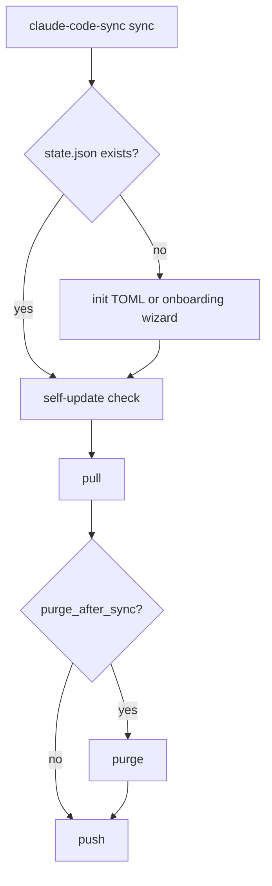

# Architecture

How `claude-code-sync` moves Claude Code history and settings through a git repository. Commands, flags and the config table live in the [README](../README.md#commands). Known bugs are listed in [TODO.md](../TODO.md) and marked "Known bug" below where they apply.

## Module map

Every git call shells out to the `git` CLI, so hooks, LFS and credential helpers work as they do for the user.

| Path | Holds |
|---|---|
| `src/main.rs` | The clap CLI. It gates every command except `init`, `config` and `self-update` behind onboarding, and runs `sync` when no subcommand is given. |
| `src/lib.rs` | The module list and `VerbosityLevel`. |
| `src/config.rs` | `ConfigManager`: the config directory and every file path inside it. |
| `src/filter.rs` | `FilterConfig` (the `config.toml` schema), the per-file include filter and the `config` setters. |
| `src/parser.rs` | JSONL entry parsing and `ConversationSession`, a one-pass summary of a transcript. |
| `src/merge.rs` | `SmartMerger`, the transcript merge. |
| `src/conflict.rs` | `ConflictDetector` and the keep-both file naming. |
| `src/interactive_conflict.rs` | The fallback for transcripts smart merge can't handle, including the keep-both copy, plus `is_interactive` and `ask_confirmation`. |
| `src/later_timestamps.rs` | `keep_later_timestamps`: merges two files that differ only in date-times. |
| `src/merge_tool.rs` | The per-file `remote` / `local` / `merge` / `stop` prompt and the external merge tool runner. |
| `src/project_map.rs` | Path encoding, project ids, the sparse checkout list and the move into mapped ids. |
| `src/purge.rs` | Retention window, purge plan, deletion and the purge commit. |
| `src/report.rs` | The conflict report in JSON, markdown or text. |
| `src/self_update.rs` | Release lookup, download, checksum, binary swap and restart. |
| `src/logger.rs` | Console logging and the log file. |
| `src/progress.rs` | Progress bar and spinner helpers. |
| `src/onboarding.rs` | The first-run wizard and the init TOML (`InitConfig`). |
| `src/git/mod.rs` | `GitRepo`: init, sparse clone, pull with conflict settling, staging, sparse checkout. |
| `src/git/attributes.rs` | The managed `.gitattributes` rules. |
| `src/git/lfs.rs` | `git lfs install --local` and the LFS attribute lines. |
| `src/sync/mod.rs` | `sync_bidirectional`, `limit_checkout` and `commit_sync_attributes`. |
| `src/sync/pull.rs`, `src/sync/push.rs` | The pull and push pipelines. |
| `src/sync/discovery.rs` | The Claude directory, transcript discovery and project-name helpers. |
| `src/sync/summary_cache.rs` | The transcript summary cache. |
| `src/sync/init.rs`, `remote.rs`, `state.rs`, `status.rs` | `init`, `remote`, `state.json` and `status`. |
| `src/artifacts/registry.rs` | The artifact categories and the per-machine toggles. |
| `src/artifacts/engine.rs` | Artifact push, pull planning, pull apply, synced hashes and the managed `.gitignore`. |
| `src/artifacts/denylist.rs` | Paths that never sync. |
| `src/artifacts/tokens.rs` | `__HOME__` / `__CLAUDE_DIR__` path tokens. |
| `src/artifacts/tracked.rs` | The per-machine record of synced paths and hashes. |
| `src/artifacts/union_jsonl.rs`, `memory_index.rs` | The prompt-history and `MEMORY.md` union merges. |
| `src/history/` | `OperationRecord`, `OperationHistory` storage and per-conversation summaries. |
| `src/undo/` | Snapshots, restore, undo of pull and push, previews and snapshot cleanup. |
| `src/handlers/` | Command handlers: `config` (wizard, interactive menu, repo selector, export), `history`, `undo`, `purge`, `cleanup-snapshots`, onboarding. |

## Sync flow

`sync` runs these steps in order. A failing pull stops it; a failing update check doesn't.



### Pull

1. Load `state.json` and `config.toml`, then set the sparse checkout (see [Project map](#project-map)).
2. Commit the managed `.gitattributes` rules if the working tree is clean and they're missing.
3. With a remote and `--fetch-remote` on, run the git merge (see [Pull merge](#pull-merge)). Commit the attribute rules again afterwards.
4. Discover transcripts on both sides and pair each repo transcript with its local destination.
5. Plan the artifact changes.
6. Read what the pull will touch into a snapshot, if anything (see [Undo](#undo-snapshots-and-history)). It stays in memory until step 10.
7. With `--interactive` in a terminal, ask `Pull?`. Answering no stops here: `~/.claude` stays untouched and no snapshot is saved.
8. Smart-merge every paired transcript whose content differs, then copy remote transcripts that don't exist locally.
9. Apply the artifact plan, then record the synced hashes.
10. Save the snapshot with the hash of every file the pull wrote or created, append the operation to the history and prune old snapshots. Steps 8–9 run as one write phase: when it fails, step 10 still runs before the error is returned, so `undo pull` reverts what was written.

> Known bug ([TODO.md](../TODO.md)): step 7 asks only after step 3 has merged the remote into the sync repo. Answering no leaves the sync repo merged.

The branch is `--branch`, else the repo's current branch, else `main`. The remote is always `origin`.

### Push

1. Refuse to run while a merge from an interrupted pull is unfinished.
2. Set the sparse checkout.
3. Discover every local transcript and drop folders named after another machine's home (see [Project map](#project-map)).
4. Plan which transcripts to copy.
5. With `--interactive` in a terminal, print the pending moves into mapped ids, the transcript plan and the artifact preview, then ask `Push?`. Answering no stops here, before anything is written to the repo or the tracked record.
6. With `enable_lfs`, run `git lfs install --local` and add the LFS lines.
7. Write the managed `.gitattributes` rules.
8. Move repo folders stored under an encoded path into their mapped id.
9. Copy each transcript whose repo copy differs. A repo copy whose last message is later stays untouched.
10. Push the artifacts, record the synced hashes and rewrite the managed `.gitignore` block.
11. Stage everything (`git add -A`, with `--sparse` on a sparse checkout) and commit. The default message is `Sync <n> sessions at <UTC time>`. Then record the operation with the commit before it.
12. With a remote and `--push-remote` on (the default), run `git push origin <branch>` when the branch has commits `origin` lacks. That includes commits left by an earlier failed push, so it runs even when step 11 had nothing to commit.

A failed `git push` makes `push` and `sync` exit with an error after the summary. The local commit and its history entry stay.

A transcript with no `cwd` can't get a project name under `use_project_name_only`; push skips it and counts it as `Skipped (no cwd)`.

## Sync repo layout

```
<sync repo>/
  .gitattributes          managed rules, plus LFS lines when enable_lfs is on
  .gitignore              managed never-sync block between marker comments
  projects/               sync_subdirectory
    <id>/                 a mapped project
    <encoded path>/       an unmapped project, e.g. -home-user-work-app
      <session>.jsonl
      <session>/subagents/...jsonl
      <session>/tool-results/...
      memory/MEMORY.md, memory/*.md
      images, PDFs and other attachments
  artifacts/
    settings/ memory/ skills/ agents/ commands/ rules/ hooks/
    plugins/ plans/ todos/ prompt-history/
    <category>/.synced    marker in categories that mirror deletions
```

`sync_subdirectory` can't be `artifacts`, `.`, absolute or contain `..`.

### Managed `.gitattributes`

These lines are appended when missing; existing lines stay:

```
* text=auto eol=lf
*.pdf binary
*.bat text eol=crlf
*.cmd text eol=crlf
*.jsonl merge=union
MEMORY.md merge=union
```

- `merge=union` makes git keep both sides' lines when two machines append to the same transcript, so transcripts rarely reach the conflict resolver.
- With `enable_lfs`, each `lfs_patterns` entry adds `<pattern> filter=lfs diff=lfs merge=lfs -text`. When both lines match a path, the later line in the file wins for `merge`.
- Adding the rules to an existing repo also runs `git add --renormalize .`, so CRLF files are stored with LF in the same commit.

### Managed `.gitignore`

Push rewrites the block between `# >>> claude-code-sync managed block` and `# <<< claude-code-sync managed block`. Lines outside the block stay. The globs mirror the [denylist](#secrets-guard).

## Project map

Claude Code names a project folder after its absolute path, so one project has a different folder name on every machine. The project map gives it one name in the repo. Usage is in the [README](../README.md#project-map).

### Names

- An encoded path replaces every UTF-16 unit that isn't an ASCII letter or digit with `-`: `/home/user/.config-dir` becomes `-home-user--config-dir`.
- A project map entry is `id = "/absolute/path"` in `[project_map]`. The id must be a plain folder name. The path must be absolute and normalized.
- `--map-project /path` uses the folder name as the id. An id already mapped to another path is refused. Two ids whose paths encode to the same folder are refused.

A local folder becomes a repo folder like this:

| Local folder | Repo folder |
|---|---|
| Encodes a mapped path | The id |
| Unmapped, `use_project_name_only` on | The last folder name of the first `cwd` in its transcripts |
| Unmapped otherwise | The encoded name itself |

A repo folder goes back to a local folder like this:

| Repo folder | Local folder |
|---|---|
| A mapped id | The encoded form of the mapped path |
| Anything, `use_project_name_only` on | The one local folder named `<name>` or ending in `-<name>`; none or several → skipped |
| Anything else | The same name, if it exists locally or looks encoded (`-…` or `X--…`); otherwise skipped |

Skipped pull files are collected per project and logged as one table, or one line per file with `warn_each_skipped_file`.

### What each side syncs

With `mapped_projects_only` on (the default):

| Data | Push | Pull |
|---|---|---|
| Transcripts | Every local folder, mapped or not | Mapped projects only |
| Attachments and project memory | Mapped projects only | Mapped projects only |
| Artifacts | Every enabled category | Every enabled category |

With it off, both sides cover every project.

Push drops a local folder that names another machine's home unless it's mapped. The check is case-insensitive:

- A folder equal to this machine's encoded home, or under it, belongs here.
- `--…` (a Windows share) belongs to another machine, except on Windows.
- `-home-…`, `-users-…` and `X--users-…` belong to another machine.
- Anything else belongs to another machine when its drive-letter form (`X--…`) doesn't match this OS.

### Sparse checkout

`limit_checkout` runs before every pull, push and purge.

- `mapped_projects_only` on → `git sparse-checkout set --cone` with `artifacts` plus `<sync_subdirectory>/<dir>` for every mapped id, every mapped path's encoded name and the repo folder of every local project folder. Root files like `.gitattributes` are always checked out.
- `mapped_projects_only` off → `git sparse-checkout disable`.
- An unchanged cone list skips the call.
- Before setting a cone, a full clone with an `origin` gets `remote.origin.promisor=true` and `partialclonefilter=blob:none`, so later fetches skip blobs outside the cone.
- `init --remote` and onboarding clone with `--filter=blob:none --sparse`.
- If setting the cone fails while `mapped_projects_only` is on, the current checkout stays and a warning is logged. With it off, the failure stops the command.

### Move into mapped ids

On every push, a repo folder under a mapped path's encoded name moves into `projects/<id>/`:

- A file that already exists under the id wins. If the dropped copy differs, a warning points at `undo push`.
- The encoded folder is then deleted, and the move lands in the push commit.

## Pull merge

The git merge of `origin/<branch>` into the sync repo runs in `GitRepo::pull`.

1. A `MERGE_HEAD` left by an interrupted pull is aborted first.
2. `git ls-remote --exit-code --heads` checks the branch. A missing branch means nothing to pull. An unreachable remote fails the pull.
3. `git fetch origin <branch>`.
4. A repo without a commit takes `FETCH_HEAD` with `git reset --hard`. An uncommitted `.gitattributes` is set aside first; any other uncommitted file stops the pull.
5. Otherwise `git merge --no-stat --no-edit -X no-renames FETCH_HEAD`.
6. On conflicts, each unmerged file is read from stages 1, 2 and 3 with `git cat-file --filters`, so LFS and EOL filters apply, and handed to the resolver.
7. All files settled → `git commit --no-edit`. Any `stop` → `git merge --abort` and the pull fails with nothing merged into `~/.claude`.

The resolver decides per file:

| Situation | Outcome |
|---|---|
| Both sides exist and differ only in date-times | The later date-times are written, no prompt |
| No terminal | The merge is aborted |
| Terminal | The prompt offers `remote`, `local`, `merge` and `stop` |

- `merge` shows only when both sides have the file and `merge_tool` is set.
- The cursor starts on `local`, or on `merge` with `prefer_merge_tool`. Esc counts as `stop`.
- Choosing a side that deleted the file runs `git rm`.

Push and every other staging call refuse to run while `MERGE_HEAD` exists.

### Later timestamps

`keep_later_timestamps` walks both files in step. At each position it reads an ISO 8601 date-time (fraction and offset optional) or a 13-digit epoch-milliseconds number on both sides and keeps the later one. Any other character must match on both sides; the first mismatch returns `None`. The same function settles artifacts changed on both machines.

### Transcript smart merge

Pull treats every paired transcript whose content hash differs as a conflict and merges it into the local file:

- Entries with a `uuid` are united by uuid. When both sides hold the same uuid with different content, the later `timestamp` wins, and a tie keeps local.
- Those entries are rebuilt into a tree from `parentUuid`. The roots are entries with no parent, or whose parent is in neither file, ordered by `timestamp` and then by uuid.
- Entries no root reaches, such as members of a `parentUuid` cycle, start trees of their own. Every entry of both files is kept.
- Entries without a `uuid` are united and deduplicated by their exact JSON.
- The result is sorted by `timestamp` and written over the local transcript. The repo copy changes on the next push.

The merge fails only when a transcript can't be read. Failed transcripts go to a fallback:

- In a terminal, a per-conversation menu shows why the merge failed and offers `local`, `remote`, `both (remote saved as a copy)` and `details`. `details` prints both copies' message counts, last update and hash, then asks again. A final `Apply?` confirms the choices; answering no stops the pull with an error.
- Without a terminal, every failed transcript gets `both`.

`both` saves the remote copy as `<session>-conflict-<UTC yyyymmdd-HHMMSS>.jsonl` next to the local transcript in `~/.claude/projects`. When a `<session>-conflict-*` copy there already holds the same content, nothing is written, so each distinct remote version is saved once. The remote copy is looked up by its repo path.

Either fallback writes `latest-conflict-report.json`, which `report` reads.

### Merge tool

`merge_tool` is split on whitespace and run with four more arguments: `<local> <remote> <base> <output>`. The files sit in a temp dir as `<stem>.local.<ext>`, `<stem>.remote.<ext>`, `<stem>.base.<ext>` and `<stem>.merged.<ext>`.

- `<output>` starts as the local content, with its mtime set 2 seconds back so a save that changes nothing still counts.
- `<base>` is git's stage 1 for a repo conflict. For an artifact pulled with `--interactive` it's empty, because no ancestor is recorded.
- The output is polled every 250 ms.

| Tool behavior | Outcome |
|---|---|
| Exits successfully after saving | The output is applied |
| Exits successfully within 5 seconds | A launcher handed off; the save is applied once the output is unchanged across two polls |
| Exits with a failure, or without saving | Nothing is applied |
| Still running after `CLAUDE_CODE_SYNC_MERGE_TIMEOUT_SECONDS` (900) | Nothing is applied and the tool is killed |

Nothing applied means `stop` in a git conflict and keep-local for an artifact.

## Artifacts engine

The artifacts engine syncs everything in `~/.claude` besides transcripts. Each category is one row in `REGISTRY`.

| Category | Source in `~/.claude` | Repo location | Merge | Path tokens | Mirrors deletions |
|---|---|---|---|---|---|
| `settings` | `settings.json`, `keybindings.json` | `artifacts/settings/` | Overwrite | Yes | No |
| `memory` | `CLAUDE.md` | `artifacts/memory/` | Overwrite | No | No |
| `skills` | `skills/` | `artifacts/skills/` | Overwrite | No | Every file |
| `agents` | `agents/` | `artifacts/agents/` | Overwrite | No | Every file |
| `commands` | `commands/` | `artifacts/commands/` | Overwrite | No | Every file |
| `rules` | `rules/` | `artifacts/rules/` | Overwrite | No | Every file |
| `hooks` | `hooks/` | `artifacts/hooks/` | Overwrite | No | Every file |
| `plugins` | `plugins/installed_plugins.json`, `plugins/known_marketplaces.json` | `artifacts/plugins/` | Overwrite | Yes | No |
| `plans` | `plans/` | `artifacts/plans/` | Overwrite | No | No |
| `todos` | `todos/` | `artifacts/todos/` | Overwrite | No | No |
| `prompt-history` | `history.jsonl` | `artifacts/prompt-history/` | Union JSONL | No | No |
| `attachments` | `projects/` except `*.jsonl` | `<sync_subdirectory>/<project>/` | Overwrite; `MEMORY.md` union | No | `<project>/memory/<file>` only |

- Toggles live in `[sync_artifacts]` and default to off. `--enable-artifacts all` and the wizard's preselection skip `hooks`; it turns on only by name.
- `attachments` has no toggle. It's on unless `exclude_attachments` is set, and it covers only projects that sync on this side.
- Files sources are stored by file name, so `plugins/installed_plugins.json` lands at `artifacts/plugins/installed_plugins.json`.
- Directory walks honor `.gitignore` files inside the source dir, include hidden files and don't follow symlinks.
- A file over `max_file_size_bytes` is skipped, but it counts as present so deletion mirroring leaves its repo copy alone.

A new category is a `CategoryId` variant, a `REGISTRY` row and an `ArtifactToggles` field wired into `is_enabled` and `set_enabled`. The registry tests assert the category count.

### Push and pull of a file

Push writes the repo copy when its bytes differ. Pull compares three versions: the local file, the repo file, and the hash both agreed on at the last sync. The comparison happens in machine form, with path tokens rendered.

| Since the last synced hash | Pull plan |
|---|---|
| Only the repo changed | Overwrite local |
| Only local changed | Keep local |
| Both changed, dates only | Write the later dates |
| Both changed, in a terminal | Ask `remote` / `local` / `merge` |
| Both changed, no terminal | Keep local and warn |
| No hash, but the path was tracked here | Treated as both changed |
| No hash and never tracked | Overwrite local |
| Local file missing | Create it, unless deletion mirroring applies |
| Same bytes, executable bit missing here | Set the bit |

- With `pull --interactive` in a terminal, every overwrite, executable-bit fix and deletion asks first.
- After every pull and push, `record_synced_hashes` stores the SHA-256 of each repo file whose local copy holds the same bytes. A file that differs keeps its previous hash. Union-merged files get no hash.

### File modes

Only the owner executable bit travels:

- A copied file keeps the destination's mode, or `0600` when new.
- The bit is added when the source has any executable bit. It's never removed.
- A `chmod +x` with no content change counts as a change on push and a mode fix on pull.

### Path tokens

`settings` and `plugins` are stored with machine paths replaced by tokens:

- Push replaces the Claude dir, then the home dir, with `__CLAUDE_DIR__` and `__HOME__`. A match must not sit inside a longer path segment.
- On Windows, both `/` and escaped `\\` spellings match.
- Pull renders the tokens back with forward slashes.
- Non-UTF-8 files pass through unchanged.

### Union JSONL

`history.jsonl` is never overwritten; both directions merge it:

- A line's identity is its `timestamp`, `project` and `display` fields when it has a `timestamp` or `display`, else the raw line.
- Lines new to the destination are appended, then all lines are stably sorted by timestamp. A line without one takes the timestamp of the line before it.

### Memory index merge

`MEMORY.md` under a project's `memory/` is merged by link target:

- An entry is a line starting with `- ` that contains `](target)`.
- The destination keeps its own lines and order. An entry whose target both sides have takes the incoming text. Entries only the incoming side has are appended.
- Entries whose target is a sibling file that doesn't exist are then dropped.
- Push merges into the repo copy; pull merges into the local copy.

### Deletion mirroring

Categories marked "Every file" in the table, plus project memory files, propagate deletions. The record is `~/.claude/.claude-code-sync-tracked.json`, keyed by the sync repo path:

- `repos`: the repo-relative paths this machine last synced.
- `synced_hashes`: the agreed hash per path. Their keys also count as tracked.

Push, when the category's source dir exists:

1. Write the `.synced` marker into `artifacts/<category>/`.
2. The pushed set is every local file plus tracked paths of projects that don't sync here.
3. Delete every tracked path missing from the pushed set from the repo, then save the pushed set as the new record.

Pull:

1. A repo file this machine deleted, unchanged in the repo since the last sync, stays deleted. The next push removes it.
2. A tracked path gone from the repo is deleted locally, after a snapshot.
3. If the local copy changed since its synced hash, it's kept with a warning, and the next push restores it.

Guards:

- No record means nothing is deleted, so a fresh clone can't wipe the repo.
- A category whose source dir is missing locally is skipped on push.
- A category missing from the repo is skipped on pull. The `.synced` marker keeps a category that lost its last file present in git.
- An attachment path whose project folder left the repo is never deleted locally.
- `undo push` drops this machine's record for the repo.

### Secrets guard

`is_denied` rejects a path when any component matches:

- `.credentials.json`, `settings.local.json`, `.claude.json`, `stats-cache.json`, `.last-update-result.json` or `mcp-needs-auth-cache.json`
- an extension of `.pem` or `.key`
- a name starting with `.env` or `daemon`
- the directories `shell-snapshots`, `session-env`, `file-history`, `paste-cache`, `cache`, `debug`, `statsig`, `backups`, `sessions` or `.trash`

Push skips denied files. Pull refuses denied or unsafe repo paths (`..`, absolute) with a warning, including tracked paths up for deletion. The `.gitignore` block repeats the list.

## Purge

Purge deletes transcripts past a retention window from `~/.claude/projects` and the sync repo together. Usage is in the [README](../README.md#purge).

- The window is `--older-than`, else `purge_older_than_days`, else the longer of 180 days and Claude Code's `cleanupPeriodDays`. That value is the larger of `settings.json` and `settings.local.json`, defaulting to 30.
- A window under 30 days is refused by the CLI and raised to 30 when read from a hand-edited config.

Planning:

1. List `<project>/<file>.jsonl` (exactly two levels deep) on both sides. In the repo, only the checked-out cone counts.
2. Group by session id across every copy.
3. A session's age is the latest `timestamp` in any copy, not the file mtime.
4. Any copy that's unreadable or has no timestamp keeps the whole session.
5. Each copy takes its sidecars: the `<session>/` dir and any `<session>.*` sibling.

Running it:

| Trigger | Asks first | Commit |
|---|---|---|
| `purge` | Yes, in a terminal; `--yes` elsewhere | Its own `Purge <n> transcripts older than <d> days` commit, not pushed |
| `purge_after_sync` | No | None; the removals land in the push commit that follows |

Both refuse to run while the sync repo has uncommitted changes.

## Undo, snapshots and history

### Snapshots

A snapshot is `<config dir>/snapshots/<uuid>.json` holding the files' bytes base64-encoded by absolute path.

A pull snapshots only when it has transcript conflicts, transcripts to copy in or artifact changes. It holds:

- the local copies of conflicting transcripts
- existing local transcripts the pull overwrites that discovery didn't list
- every artifact file the pull overwrites, unions or deletes
- `MEMORY.md` files beside deleted memory files
- the tracked record

It also lists `deleted_files`: the transcripts, keep-both copies and artifact files the pull creates, and the tracked record when the pull creates it. `written_hashes` holds the SHA-256 of every snapshotted and created file as the pull left it.

The snapshot is written to disk at the end of the pull, even when the pull failed partway, so a pull cancelled at `Pull?` leaves none.

Push takes no file snapshot. Its history record stores the commit hash before the push.

After every pull and push, a snapshot is deleted once it's past the 5 newest of its type and older than 7 days. `cleanup-snapshots` runs the same rule with its own limits.

### Undo

`undo pull`:

1. Find the newest pull in the history and load its snapshot.
2. Check that every path in `deleted_files` and the snapshotted files resolves inside the home directory. One outside → stop before touching anything.
3. Delete each of the `deleted_files` and write back each snapshotted file, skipping any file whose hash differs from `written_hashes`: it changed since the pull and is kept with a warning.
4. Drop that history entry and delete the snapshot file.

`--preview` lists the files step 3 will delete, restore and keep.

`undo push`:

1. Find the newest push in the history.
2. `git reset --soft` to the commit before it. The pushed files stay in the working tree and index, so the next push commits them again unless they change.
3. Drop that history entry.
4. Forget this machine's tracked record for the repo.
5. With an `origin`, print the `git push --force` the remote now needs.

A failed restore or reset stops the undo before its history entry and snapshot are dropped, so you can run it again.

In a terminal, both ask first. Since each successful undo drops its entry, the next one goes one operation further back while history and snapshots last.

### Operation history

`operation-history.json` holds the 5 newest operations, pulls and pushes mixed, newest first. Each records its branch, per-conversation summaries, artifact counts and the snapshot path or commit hash. A push records only when it committed something.

## Self-update

`sync` updates itself before it pulls; `self-update` does the same work on request.

1. Any value in `CLAUDE_CODE_SYNC_NO_UPDATE` skips the check.
2. `GET <repository>/releases/latest` without following redirects, with a 10-second timeout. The tag comes from the `Location` header (`/releases/tag/<tag>`).
3. A tag that isn't newer by semver ends the check.
4. A binary under `/.cargo/bin/` only prints `cargo install --locked --git <repository>` and syncs on.
5. A platform without a release asset syncs on silently.
6. Download `<repository>/releases/download/<tag>/<asset>` and `<asset>.sha256`, with a 120-second timeout and a 200 MB cap. The checksum file's first word must equal the archive's SHA-256.
7. Extract `claude-code-sync` (`claude-code-sync.exe` on Windows) and replace the running binary with `self_replace`.
8. Restart with the same arguments and `CLAUDE_CODE_SYNC_NO_UPDATE=1`. Unix uses `exec`. Windows waits for the child and exits with its code.

Any failure is logged as a warning and the sync continues on the current version. `<repository>` is `CARGO_PKG_REPOSITORY`.

| OS | Arch | Asset |
|---|---|---|
| Linux (glibc) | x86_64, aarch64 | `claude-code-sync-linux-<arch>.tar.gz` |
| Linux (musl) | x86_64, aarch64 | `claude-code-sync-linux-<arch>-musl.tar.gz` |
| macOS | x86_64, aarch64 | `claude-code-sync-macos-<arch>.tar.gz` |
| Windows | x86_64, aarch64 | `claude-code-sync-windows-<arch>.exe.zip` |

`self-update` differs from the `sync` path:

- It asks first. Outside a terminal it needs `--yes`.
- It refuses a cargo-owned binary without `--force`.
- `--to <version>` accepts a missing `v` and allows downgrades.

Windows builds use native TLS; others use rustls.

## Environment variables

| Variable | Effect |
|---|---|
| `CLAUDE_CODE_SYNC_CONFIG_DIR` | The config dir becomes `<value>/claude-code-sync`. Tests rely on it, which is why the suite runs with `--test-threads=1`. |
| `CLAUDE_CODE_SYNC_CLAUDE_DIR` | Replaces `~/.claude`. Path tokens keep using the real home dir. |
| `CLAUDE_CODE_SYNC_INIT_CONFIG` | Path of the init TOML; used only if the file exists. |
| `CLAUDE_CODE_SYNC_NO_UPDATE` | Any value skips the update check in `sync`. |
| `CLAUDE_CODE_SYNC_MERGE_TIMEOUT_SECONDS` | How long to wait for the merge tool. Defaults to 900. |
| `XDG_CONFIG_HOME` | The config dir base on Linux. |
| `RUST_LOG` | The console log level. Defaults to `info`. |

Empty values of the first two count as unset.

## Config and state files

The config dir is:

| OS | Path |
|---|---|
| Linux | `$XDG_CONFIG_HOME/claude-code-sync`, else `~/.config/claude-code-sync` |
| macOS | `~/Library/Application Support/claude-code-sync` |
| Windows | `%APPDATA%\claude-code-sync` |
| Other | `~/.claude-code-sync` |

| File | Holds |
|---|---|
| `config.toml` | `FilterConfig`: filters, LFS, artifacts, project map, purge, merge tool. Missing means defaults. See the [README](../README.md#configuration). |
| `state.json` | The sync repos: v2 is `{version, active_repo, repos: {name: {sync_repo_path, has_remote, is_cloned_repo, remote_url, description}}}`. A v1 single-repo file is read too. The repo selector, `config --export`, and `remote set` or `remote remove` on `origin` rewrite it as v2. Its presence means "initialized". |
| `operation-history.json` | The last 5 operations. |
| `snapshots/` | Undo snapshots. |
| `latest-conflict-report.json` | The last transcript conflict report. |
| `session-summaries.json` | The transcript summary cache. |
| `claude-code-sync.log` | The log file, rotated to `.log.old` past 10 MB. |
| `repo/` | The default clone location. |
| `init.toml` | The init TOML, third in lookup order. |

Outside the config dir:

- `~/.claude/.claude-code-sync-tracked.json` is the [deletion-mirroring](#deletion-mirroring) record. It's never synced.
- Init TOML lookup order is `$CLAUDE_CODE_SYNC_INIT_CONFIG`, then `~/.claude-code-sync-init.toml`, then `<config dir>/init.toml`. `config --export` writes `./.claude-code-sync-init.toml`. Format is in the [README](../README.md#non-interactive-setup).
- An init TOML sets the repo, remote, clone, `exclude_attachments`, `exclude_older_than_days`, `enable_lfs`, `sync_subdirectory`, `use_project_name_only` and `sync_artifacts`.

### Summary cache

Discovery and purge summarize transcripts in parallel with rayon. Each summary holds the session id, latest timestamp, message count, first `cwd` and content hash.

- `session-summaries.json` caches them by path.
- An entry is reused while the file's length and mtime match.
- The whole cache is dropped when a hash of `src/parser.rs`'s source changes.

### Logging

`env_logger` writes to stdout at the `RUST_LOG` level. The log file receives only the startup line `Logger initialized with level: …`; other log calls don't reach it.
